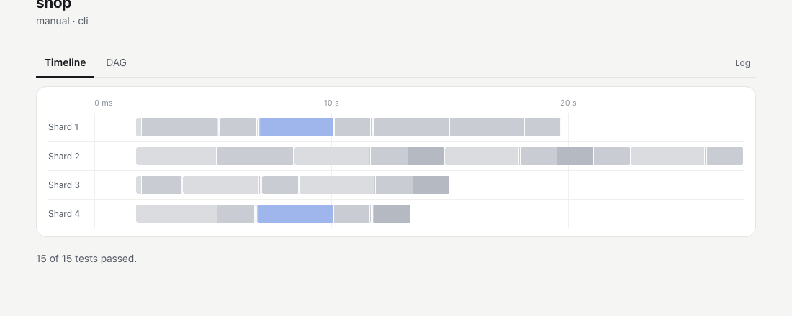

# localci

Run your end-to-end tests and pull-request checks on your own machines, for people and for coding agents.

localci shards a Playwright suite across the CPUs you already have, gives every shard its own stack and database,
and ends each failed run with a report an agent can act on: the failing step, expected against actual, the page as the
test saw it, console errors, failed requests, and the paths of the screenshot and trace. It also runs your
repository's GitHub Actions workflows locally, so a pull request gets its checks without a hosted runner.



## Install

```bash
brew install nesolva/tap/localci                                          # macOS and Linux
curl -fsSL https://github.com/nesolva/localci/releases/latest/download/install.sh | sh
go install github.com/nesolva/localci/cmd/localci@latest                  # needs Go
```

In your Playwright project:

```bash
npm i -D @nesolva/localci-playwright
```

Run `localci doctor` to see what your machine is missing. Docker, `act` and `mise` are optional.

## Quickstart: the sample

About ten minutes, most of it downloading the browser. You need Node 20 or newer.

```bash
git clone https://github.com/nesolva/localci
cp -R localci/examples/acme-shop ~/acme-shop && cd ~/acme-shop
git init -q -b main && git remote add origin https://github.com/acme/shop.git   # the name localci.yaml uses
npm install && npx playwright install chromium
git add -A && git commit -qm sample

# localci clones repositories from GitHub. Point the sample's made-up address at this folder instead:
git config --global url."$PWD".insteadOf https://github.com/acme/shop.git

export LOCALCI_CONFIG="$PWD/localci.yaml"   # the sample's config; a config you already have stays untouched
localci serve &                      # the server every command talks to; dashboard at http://127.0.0.1:7357
localci run --wait                   # four shards of the sample suite
```

The last line says how it ended: `#1 passed 15/15 · 27s`. Open the dashboard to see the four shards on a timeline. To
see a failure report, break something in `server.js`, run again, and use the id the run printed:

```bash
localci show 2                       # the first failure, with the evidence
localci triage 2                     # product bug, test bug, flaky or infrastructure
localci run --failed 2 --wait        # only what failed
```

When you are done: stop `localci serve`, `unset LOCALCI_CONFIG`, and remove the redirect with
`git config --global --unset url."<the folder you used>".insteadOf`.

## Your own project

1. In your Playwright project: `npm i -D @nesolva/localci-playwright @playwright/test` (Playwright 1.49 or newer).
2. Wrap the config, `export default withLocalci(defineConfig({...}))`, import `test` and `expect` from
   `@nesolva/localci-playwright`, and make `baseURL` and `webServer` read the port from `process.env.PORT`.
3. Add a suite to `~/.config/localci/config.yaml`. The [suites page](docs/suites.md) starts from the smallest one; the repository
   name must equal the owner and name of your checkout's `origin` remote.
4. `localci doctor` lists what the machine lacks. A failing `gh auth` matters only for pull-request checks and
   watching; local runs do not need it.
5. Start `localci serve` (or `localci service install` to keep it running at login), then `localci run --wait` from
   inside the repository. It tests your working tree, uncommitted tracked changes included; keep `node_modules` in
   `.gitignore`.

[`examples/`](examples) has a Postgres stack, a pytest suite for an HTTP API, a suite across two repositories and pull-request checks, and
[the configuration reference](docs/config.md) lists every setting. For an agent, [the agent guide](docs/agents.md) and the
skill cover the rest.

## What it does

- **Sharded runs.** Tests are split by measured duration. Each shard gets its own copy of your stack and a database
  cloned from a template, so shards cannot disturb each other. Tests that touch global state are found by running,
  not by you declaring it, and move to a serial group. See [isolation levels](docs/isolation.md).
- **Reports for agents.** One line per item, stable exit codes, `--json` for everything. An [agent skill](docs/agents.md)
  teaches the loop: run, wait, show, triage, fix, run only what failed.
- **Affected tests.** `localci run --affected` runs the tests your diff can reach, by per-test coverage, and everything
  when it cannot tell safely.
- **Flows and checkpoints.** Write sign-in or tenant setup once as a [flow](docs/flows.md); localci restores its
  result for later tests instead of repeating it.
- **Triage.** A failed test is rerun to rule out flakiness, then called a product bug, a test bug, flaky or
  infrastructure, with the evidence. A broken selector becomes a patch you review, never a silent change.
- **Pull-request checks.** The jobs in `.github/workflows` run on your machine with caches warm, using the merge
  result, `paths` filters, matrices and `services:`, and post commit statuses back. Every check posts its own status,
  `localci/<workflow>/<job>`. When two matrix cells have the same name, each gets GitHub's cell suffix, as in
  `localci/CI/test linux (linux, 18)`, so a failing cell is never hidden by a passing one. Retrying a check reruns that
  check only.
  A job with `services:` runs in a container that shares its services' network, so `localhost:<port>` and the
  service name both work, as on GitHub's runners; nothing is published on your machine, so your own Postgres on 5432
  is left alone. A `ports:` remap like `5433:5432` is not applied (the job log says which port to use). A step
  without `shell:` runs `bash -e`, and `shell: bash` adds `pipefail`, as on GitHub.
- **Nightly exploration.** An [agent](docs/explore.md) explores your app against goals you write and reports what it
  finds. It never gates a merge.
- **Workers (experimental).** [Another machine](docs/workers.md) can join and run shards. It has not been tried on
  separate real hardware yet.

## How it differs

**From hosted CI.** The hardware is yours, so there is no queue and no minutes to pay for, and a run starts from your
working tree, uncommitted changes included. You give up a clean, identical machine for every run, and nothing runs
while your machine is off. Use localci for the fast loop and, if you want, for pull requests; keep hosted CI where you
need a reproducible environment.

**From `act`.** `act` runs one workflow in containers. localci runs workflow `run:` steps natively and uses `act` only
for third-party actions. On top it adds the suite runner: sharding, per-shard stacks and databases, and the
reports. If you only want to try one workflow locally, `act` is simpler.

## Documentation

[docs/](docs/README.md): configuration, the agent guide, flows, isolation, the protocol, the [security model](docs/security.md)
and [troubleshooting](docs/troubleshooting.md). To contribute see [CONTRIBUTING.md](CONTRIBUTING.md).

## What it does with your code

Everything runs on your machine, as your user. localci talks to GitHub with your credentials and to nobody else. See the
[security model](docs/security.md), and [SECURITY.md](SECURITY.md) to report a problem.

## License

MIT. See [LICENSE](LICENSE).
